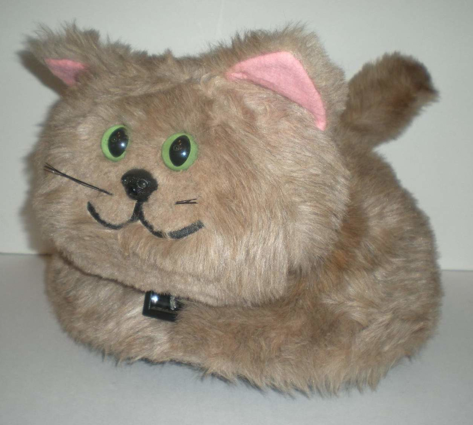

## The Petster Deluxe

An archival and reverse-engineering workspace for the Axlon Petster Deluxe electronic pet.



### What is preserved

Petster Deluxe is an electronic pet with a microprocessor-controlled behaviour system. It responds to sounds and touch, can be led by a leash, and uses forward sensing to avoid obstacles.

The central artifact is a 4 KiB ROM image. The 8039 is an Intel MCS-48-family controller with external program memory; the bundled 8048-family references and tools are included to support investigation of that ROM.

| Path | Purpose |
| --- | --- |
| [`code/petster.bin`](code/petster.bin) | Canonical 4,096-byte ROM image. |
| [`code/petster.hex`](code/petster.hex) | Intel HEX encoding of the canonical ROM. |
| [`code/petster-array`](code/petster-array) | C-style byte-array representation. |
| [`code/PetsterDeluxeEprom.zip`](code/PetsterDeluxeEprom.zip) | Original-style archive containing the same ROM payload. |
| [`docs/`](docs) | Owner's manual, technical guide, and reference material. |
| [`docs/TECHNICAL-RESEARCH.md`](docs/TECHNICAL-RESEARCH.md) | Sourced 1985 hardware findings, preserved teardown, and open questions. |
| [`datasheets/`](datasheets) | INS8039-family reference datasheet. |
| [`docs/UNIT-OBSERVATIONS.md`](docs/UNIT-OBSERVATIONS.md) | Owner-reported markings and the evidence still needed from this specific cat. |
| [`tools/`](tools/README.md) | Period 8048/8039 development and analysis tools. |

### Integrity and provenance

The ZIP payload and Intel HEX file both resolve byte-for-byte to `code/petster.bin`. The canonical ROM is 4,096 bytes and has this SHA-256 digest:

```text
609d6505297a6365abb4fdbd869a2d76aad65ebd2accc628e37023a11ffefee9
```

Run the following from the repository root to verify those representations:

```sh
./scripts/verify-rom.sh
```

The check requires standard POSIX utilities plus `unzip`, GNU `objcopy`, and `sha256sum`.

See [`docs/TECHNICAL-RESEARCH.md`](docs/TECHNICAL-RESEARCH.md) before working on hardware. It records the 1985 external-ROM architecture, the ROM's verified used range, and the checks needed before attaching an adapter.

### Reverse-engineering status

This project does not yet contain a validated disassembly. Earlier generated listings were removed because one decoded the ROM as Motorola 68HC11 instructions and another as x86; neither is valid for an MCS-48-family target.

Treat `petster.bin` as the source of truth. A future disassembly should identify the exact MCS-48 tool and version, command line, ROM base address, CPU variant, and the byte ranges classified as code versus data. Contributions that add labels, hardware mappings, or behavioural analysis should cite the supporting manual, board observation, or ROM addresses.
