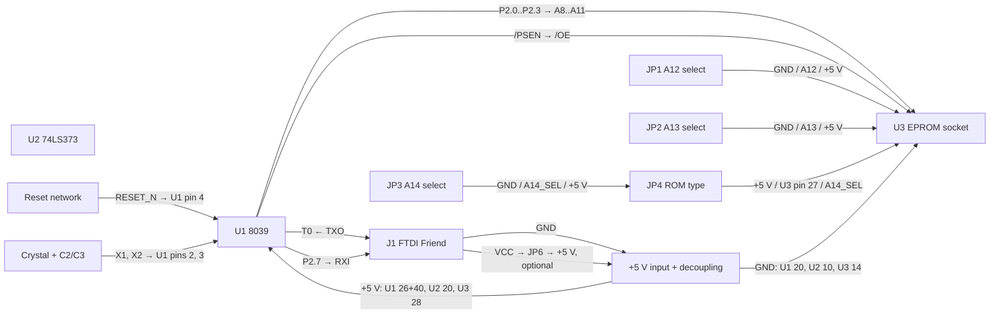

# 8039-II-SBC wiring review — 2026-11-03

## Result

The schematic is **not ready for layout or bring-up**. KiCad 10 ERC reports
**77 errors** (0 warnings). The multiplexed `AD0`–`AD7` data path and the
`74LS373` appear wired, but the support circuitry and all high-address/ROM
selection wiring remain electrically open. Several labels are merely placed
near wires and do not electrically join a net.

## Must fix before a PCB

1. **Complete the ROM address/control wiring.** U3 pins `A8`–`A13`, pin 27
   (`/PGM`), and pin 1 (`VPP`) are all disconnected. JP1–JP4 and JP3 have no
   electrically connected pins. This leaves the 27C128/27C256 bank selection
   and ROM-type selection inoperative.

2. **Complete the MCU high-address/console wiring.** U1 `P2.0`–`P2.3` are
   open instead of driving `A8`–`A11`; `P2.7` is open instead of going to the
   FTDI RXI input; and `T0` is open instead of receiving FTDI TXO. All six J1
   pins are currently open, including ground and VCC/USB-power-jumper pins.

3. **Wire the reset components.** R1 and D1 have both leads open. Verify the
   intended reset net contains the pull-up, capacitor, pushbutton, and
   discharge diode, and that the diode orientation provides a rapid discharge
   when +5 V falls.

4. **Add an actual +5 V input and decoupling.** The schematic currently has
   no connected board-power entry. ERC reports the +5 V power symbols as
   undriven. C4–C6 and the input bulk capacitor are still only mentioned in a
   note; they are not schematic components.

5. **Attach or remove dangling labels.** `AD0`–`AD7`, `T0_RX`, and `P27_TX`
   produce dangling-label errors. The bus wires themselves are connected, but
   these labels do not land on their wires. Snap labels/wire ends to the
   1.27 mm schematic grid and rerun ERC.

## Explicitly resolve (or mark No Connect)

U1 `P1.0`–`P1.7`, `P2.4`–`P2.6`, `PROG`, `T1`, `/RD`, and `/WR` are currently
unconnected. If they are deliberately unused in Rev A, place KiCad no-connect
flags on them; otherwise expose the required test/header connections.

The FTDI header's `CTS` and `DTR` are documented as unused, but need
no-connect flags after the header is wired.

## Design decisions still open

* Select and document the exact 8039-compatible MCU, including the fixed
  external-program `EA` level and oscillator limits.
* Verify the selected EPROM's pin 1 / VPP and pin 27 / PGM requirements,
  particularly before allowing a 27C256.
* Choose actual reset and oscillator component values from those parts'
  datasheets; the schematic still marks the load capacitors DNP/verify.
* Define the physical +5 V source, connector, protection, and bulk-capacitor
  value. Do not rely on the normally-open FTDI VCC jumper as the only implied
  power source.

## Verification performed

Ran KiCad 10.0.8 ERC on `8039-II-SBC.kicad_sch` with all severities enabled:
`77` errors, `0` warnings. This review does not modify the schematic.

## Wiring map to draw

Use this as the actual connection list. A three-pin selector is drawn with pin
2 in the centre; a shunt connects pin 2 to pin 1 or pin 3.

### 8039 to latch and ROM

| Net | Connect these pins |
| --- | --- |
| `AD0`–`AD7` | U1 `DB.0`–`DB.7` (pins 12–19) → U2 `D0`–`D7` → U3 `D0`–`D7` (pins 11–13, 15–19). Keep each bit in the same order. |
| `A0`–`A7` | U2 `Q0`–`Q7` → U3 `A0`–`A7` (pins 10, 9, 8, 7, 6, 5, 4, 3). |
| `ALE` | U1 pin 11 → U2 `LE` (pin 11). |
| latch enable | U2 `/OE` (pin 1) → GND; it must be permanently enabled. |
| `A8`–`A11` | U1 `P2.0`–`P2.3` (pins 21–24) → U3 `A8`, `A9`, `A10`, `A11` (pins 25, 24, 21, 23). |
| ROM output enable | U1 `/PSEN` (pin 9) → U3 `/OE` (pin 22). |
| ROM chip enable | U3 `/CE` (pin 20) → GND. |

Do **not** connect U1 `/RD` or `/WR` to this ROM: they are for external data
memory and are unused by the program-ROM circuit.

### Manual bank and ROM-type selectors

| Header | Pin 1 | Pin 2 (centre) | Pin 3 |
| --- | --- | --- | --- |
| JP1 | GND | U3 `A12` (pin 2) | +5 V |
| JP2 | GND | U3 `A13` (pin 26) | +5 V |
| JP3 | GND | `A14_SEL` | +5 V |
| JP4 | +5 V | U3 `/PGM` (pin 27) | `A14_SEL` |

For a 27C128, shunt JP4 pins 1–2 so `/PGM` is high. For a 27C256, shunt
JP4 pins 2–3 so socket pin 27 follows `A14_SEL`; select that address bit on
JP3. U3 pin 1 (`VPP`) is +5 V in normal read operation for the 27C128/27C256
family represented by the chosen symbol. Confirm the exact EPROM's data sheet
before fitting it.

The 8039 has no internal program ROM; for the Intel MCS-48 pinout, EA is
active high for external program fetches. Wire U1 `EA` (pin 7) to +5 V for
this board. Replace the current two-pin “EA SELECT” header with either a
direct +5 V connection, or a three-pin `GND—EA—+5 V` selector if a selectable
option is genuinely required. Do not change EA while running.

### Reset, clock, power, and FTDI

| Net/function | Connect these pins |
| --- | --- |
| reset | +5 V → R1 → `RESET_N`; `RESET_N` → U1 `/RESET` pin 4, C1 → GND, and SW1 → GND. D1 anode → `RESET_N`; D1 cathode → +5 V, so C1 discharges when the supply falls. |
| oscillator | U1 `X1` pin 2 → Y1 pin 1 and C2 → GND. U1 `X2` pin 3 → Y1 pin 2 and C3 → GND. Choose C2/C3 from the selected MCU/crystal specifications. |
| board power | Add a real power-input header: `+5 V` and GND. Its +5 V rail supplies U1 pins 26 (`VDD`) and 40 (`VCC`), U2 pin 20, and U3 pin 28; ground supplies U1 pin 20, U2 pin 10, and U3 pin 14. |
| FTDI | J1 pin 1 → GND; pin 3 (`VCC`) → JP6 pin 1; JP6 pin 2 → +5 V; pin 4 (`TXO`) → U1 `T0` pin 1; U1 `P2.7` pin 38 → J1 pin 5 (`RXI`). J1 pins 2 (`CTS`) and 6 (`DTR`) are no-connect in Rev A. |

JP6 must remain unshunted by default. It only lets an FTDI Friend power the
board intentionally; the normal board input above is still required.

### Required schematic additions

Add C4, C5, and C6 as 100 nF capacitors directly across U1, U2, and U3's
supply pins, plus a bulk capacitor (for example 10 uF) across the board's
power input. Place KiCad no-connect flags on deliberately unused U1 pins:
`P1.0`–`P1.7`, `P2.4`–`P2.6`, `PROG`, `T1`, `/RD`, `/WR`, plus J1 CTS/DTR.

## Remaining wiring diagram

