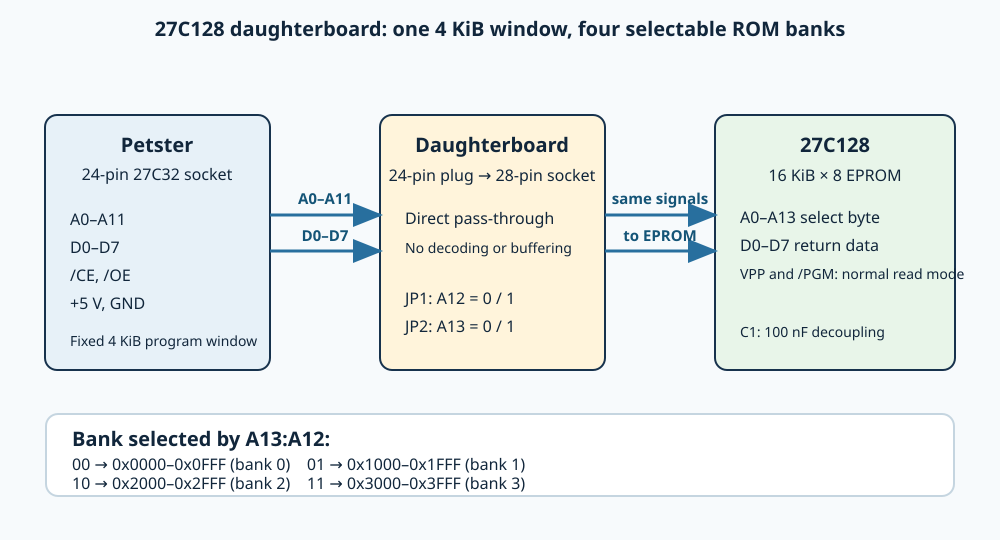

# Petster 27C128 daughterboard

This is the active KiCad project for a passive, bank-selected adapter from
the Petster's 24-pin National `NMC27C32` socket to a 28-pin `27C128` EPROM.
It is for the external-ROM Petster revision.

The PCB is routed and has passed KiCad DRC with zero violations and zero
unconnected items. The manufacturing output is
[`production/27c128-daughterboard.zip`](production/27c128-daughterboard.zip).

## Function

`J1` is a 24-pin male-DIP plug on the underside. `U1` is the 28-pin EPROM
socket on top. The original address, data, enable, power, and ground signals
route directly between their equivalent pins. `JP1` selects A12 and `JP2`
selects A13, giving four 4 KiB banks. Change shunts only while the Petster is
unpowered.

### How a 24-pin socket accesses a 27C128

The Petster was designed for a 27C32: a 4 KiB × 8 EPROM with twelve address
inputs, `A0`–`A11`. The 8039 therefore always fetches from one 4 KiB program
window. Its multiplexed low address/data bus is latched externally, the upper
four address bits supply `A8`–`A11`, and `/CE` and `/OE` enable each EPROM
read.

The 27C128 is electrically compatible at the data and control interface, but
has 16 KiB of storage and therefore needs two more address inputs, `A12` and
`A13`. The board passes the original socket's `A0`–`A11`, `D0`–`D7`, `/CE`,
`/OE`, `+5 V`, and ground straight to their 27C128 equivalents. It adds no
logic, buffering, or address decoder.

The extra inputs are held at a defined logic level by the two three-pin
jumpers. Each jumper connects its address input to either ground (0) or +5 V
(1). The processor remains unaware of this selection: it still requests local
addresses `0x000`–`0xFFF`, but the jumper levels choose which physical 4 KiB
region in the 27C128 supplies the bytes. For example, with `A13:A12 = 10`, a
fetch from the processor's `0x000` is read from physical 27C128 address
`0x2000`.

| JP2 / A13 | JP1 / A12 | Exposed 27C128 address range | Bank |
| ---: | ---: | --- | ---: |
| 0 | 0 | `0x0000–0x0FFF` | 0 |
| 0 | 1 | `0x1000–0x1FFF` | 1 |
| 1 | 0 | `0x2000–0x2FFF` | 2 |
| 1 | 1 | `0x3000–0x3FFF` | 3 |

`VPP` and `/PGM` are tied to the voltage required by the fitted EPROM's normal
read mode; check the exact 27C128 manufacturer's datasheet before fitting.
C1 is a 100 nF ceramic bypass capacitor across the EPROM supply pins. Install
one shunt on each jumper: a floating address input makes bank selection
undefined. Never move a shunt while the Petster is powered; change banks with
power removed, or while the MCU is positively held in reset.

The complete functional pin map and bank truth table are in
[`SCHEMATIC-REVIEW.md`](SCHEMATIC-REVIEW.md). The release and assembly checks
are in [`PRODUCTION-READINESS.md`](PRODUCTION-READINESS.md).

## Assembly

Fit the 24-pin male plug, a 0.600-inch-wide 28-pin socket, both three-pin
headers and shunts, and C1 (100 nF ceramic). The PCB has no voltage regulator:
it uses the Petster's existing +5 V supply.
