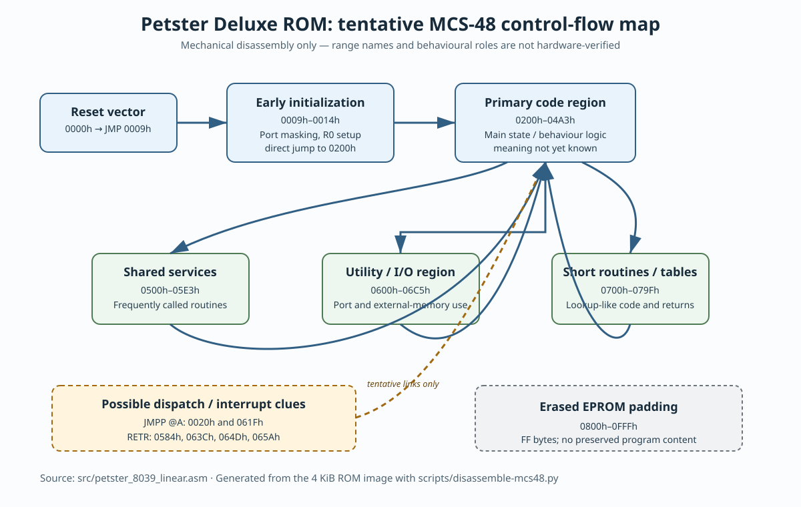

# Petster Deluxe ROM control-flow map



The editable Mermaid source is
[`rom-control-flow.mmd`](rom-control-flow.mmd). Update it first when refining
the map, then regenerate the SVG with the chosen Mermaid renderer.

This is a navigation aid for the mechanical MCS-48/INS8039 listing in
[`petster_8039_linear.asm`](petster_8039_linear.asm). It is **not** a verified
description of Petster behaviour, sensor wiring, motor control, or interrupt
assignment.

## Evidence represented

* The reset vector at `0000h` directly jumps to `0009h`.
* The instructions at `0009h–0014h` mask port bits, initialise `R0` and then
  jump to `0200h`.
* The map groups address ranges by their density of direct calls, jumps,
  returns, and MCS-48 port/external-memory instructions.
* `JMPP @A` at `0020h` and `061Fh` suggests table-driven dispatch.
* `RETR` opcodes occur at `0584h`, `063Ch`, `064Dh`, and `065Ah`; these are
  potential interrupt-return paths, but the associated entry vectors are not
  yet proven.
* `0800h–0FFFh` is erased (`FF`) padding in the 4 KiB EPROM image.

## How to use it

Start at the reset path, then use the byte-accurate listing to follow a call
or jump target. Treat range names such as “shared services” and “utility/I/O”
as organizational labels only. Assigning a range to a Petster sensor or
actuator requires a physical continuity measurement, a confirmed CPU-port
map, or a controlled observation of the original firmware.

The underlying listing can be recreated without changing the binary:

```sh
python3 scripts/disassemble-mcs48.py \
  'src/Petster Deluxe Eprom (Burnt on a 27c32 eprom).bin' \
  src/petster_8039_linear.asm
```
